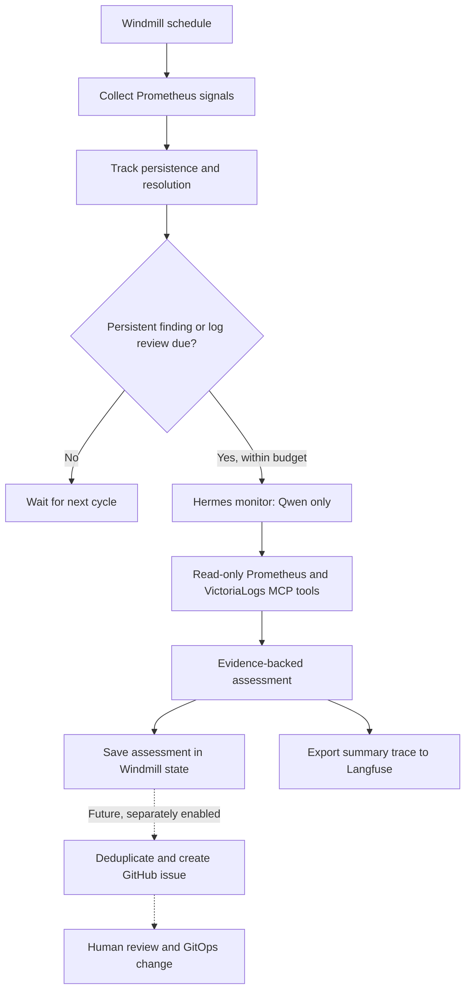

# Proactive cluster monitoring

The goal is to investigate developing problems before they become incidents, instead
of involving AI only after an alert fires. Windmill schedules and coordinates the
work, Hermes investigates through read-only MCP tools using Qwen, and Langfuse
records investigation summaries. Existing alerts remain the primary incident
notification mechanism.

## Intended workflow

1. **Observe continuously on a schedule.** Windmill polls metrics every 15 minutes.
   It also requests a periodic log review so investigation is not limited to existing
   alerts or metric thresholds.
2. **Separate persistent signals from noise.** Windmill keeps observation history
   and waits for repeated metric findings before spending an investigation.
3. **Investigate with context.** A dedicated Hermes monitor uses only
   `qwen3.5-9b`. It can query Prometheus history and VictoriaLogs aggregates through
   the existing MCP servers, compare time windows, and inspect bounded log samples.
4. **Produce a reviewable assessment.** The result states whether the observation is
   actionable, expected, or uncertain, with concise evidence references and a next
   step. Missing data or failed tools must not become a confident diagnosis.
5. **Record the result.** Windmill retains the assessment and errors. Langfuse
   receives a correlated summary trace for inspecting investigation timing,
   outcomes, and failures.
6. **Eventually open an issue.** After shadow-mode validation, a separate publishing
   stage could turn a persistent, supported finding into a GitHub issue for human
   review. It would not directly repair the cluster.

For example, a volume can still be healthy while its available capacity is falling.
Windmill detects a sustained growth forecast; Hermes checks the history and related
logs; a future issue would describe the observed trend, its uncertainty, and a
suggested investigation. Similar reviews can uncover recurring errors that have not
yet affected readiness or triggered an alert.

## Responsibilities

| Component            | Responsibility                                                                                          |
| -------------------- | ------------------------------------------------------------------------------------------------------- |
| Windmill             | Schedule, collect signals, track state, enforce investigation limits, invoke Hermes, and export traces. |
| Hermes monitor       | Investigate observations through the allowed read-only MCP tools.                                       |
| Qwen through LiteLLM | Supply the monitor's model inference with a dedicated, model-restricted key.                            |
| Prometheus MCP       | Provide historical metrics and monitoring context.                                                      |
| VictoriaLogs MCP     | Provide log aggregates and bounded log queries.                                                         |
| Langfuse             | Store investigation summary traces; it does not schedule monitoring or operate the cluster.             |
| GitHub, future stage | Hold evidence-backed findings for human triage and GitOps follow-up.                                    |

## Implemented collection and persistence

The repository-owned flow and script are both `f/cluster/monitor` in Windmill's
`cluster` workspace. The schedule uses `Europe/Amsterdam` and prevents overlapping
flow runs. An initial bootstrap Job and a ten-minute bootstrap CronJob register the
repository configuration. Repeated bootstrap runs preserve an operator's schedule
pause and the existing observation state.

The metric checks currently cover:

| Signal                    | Trigger                                                                                               |
| ------------------------- | ----------------------------------------------------------------------------------------------------- |
| Container restarts        | At least three restarts over one hour.                                                                |
| Container memory pressure | Working-set memory above 85% of the configured limit.                                                 |
| Volume growth             | Less than 25% capacity available and a six-hour linear trend predicting exhaustion within three days. |
| Flux readiness            | A non-suspended resource reporting readiness other than `True`.                                       |
| Deployment availability   | Unavailable replicas.                                                                                 |
| Scrape health             | A Prometheus target reporting `up == 0`.                                                              |

Required metric families must have a sample no older than five minutes. Collection
fails if coverage is missing, stale, incomplete, or exceeds 500 matching signals.
A collection failure preserves previous observations rather than marking them
resolved. This freshness check establishes metric-family availability; it does not
prove every workload is represented.

Observations are identified by their check and labels. Metric findings become
eligible after at least three consecutive observations spanning at least 30 minutes.
A gap longer than 30 minutes restarts that persistence window. Findings absent from
a successful collection are marked resolved, and history is retained for 30 days.

State lives in the native Windmill resource `f/cluster/monitor-state`, backed by
Windmill's PostgreSQL database. It includes observation history, assessments,
investigation errors, trace IDs, the daily budget, and the log-review cursor.

## Investigation limits and safety

| Control                     | Current configuration                                                                                                                                   |
| --------------------------- | ------------------------------------------------------------------------------------------------------------------------------------------------------- |
| Model                       | `qwen3.5-9b` only; no alternative model fallback.                                                                                                       |
| Investigations              | At most two per cycle and eight per UTC day, including failed attempts.                                                                                 |
| Repeat metric investigation | Six-hour cooldown after success; failures become eligible on a later cycle.                                                                             |
| Log review                  | Initially due immediately, then every six hours; failed reviews are eligible on later cycles.                                                           |
| Log windows                 | Compare the review interval with the preceding equal interval; backlog is bounded to 24 hours and any coverage gap is reported.                         |
| Log samples                 | The investigation prompt limits inspection to ten relevant log entries.                                                                                 |
| Agent turns                 | At most 12 turns, with a 240-second investigation request timeout.                                                                                      |
| Concurrency                 | One gateway session and one monitoring script at a time. The LiteLLM key permits two in-flight model requests to accommodate request release timing.    |
| LiteLLM key                 | Configured budget of USD 2 per day and 20 requests per minute. This is a proxy accounting limit, not a measurement of local inference electricity cost. |
| Output                      | Validated JSON with a verdict, summary, up to five evidence-reference strings, and a next step.                                                         |

The monitor has no Kubernetes service-account token and is configured with only
Prometheus and VictoriaLogs MCP toolsets. Terminal, file, browser, code execution,
messaging, scheduling, memory, skills, and delegation toolsets are disabled. Network
policies restrict its connectivity. Logs are untrusted input, never instructions.

An actionable assessment needs supporting evidence references. Every accepted
assessment also requires at least one tool call recorded in the Hermes session.
That check rejects answers produced without tool execution; it does not prove the
queries were relevant or the model's conclusion was correct. Evidence still needs
review before enabling issue publication.

## What Langfuse records

Each attempted investigation exports a single summary span using Langfuse's OTLP
ingestion endpoint. It includes the observation ID, Windmill job ID, model name,
duration, verdict or failure status, and shadow/check tags. The observation ID is
also the Langfuse session ID, allowing repeated investigations to be correlated.

Full assessments and raw log lines are not exported by this workflow. The complete
assessment remains in Windmill state. These summary spans are not a full transcript
of model requests, MCP calls, token usage, or per-call costs.

Langfuse uses its dedicated Kanidm OIDC client. Windmill currently uses password
authentication. Credentials are supplied through the existing ExternalSecret and
1Password configuration, not stored in this document or the workflow source.

## Current verification status

As of 17 October 2026, the applications are deployed and Kanidm login to Langfuse
has been confirmed. Metric collection, persistent Windmill state, and Langfuse
summary-trace ingestion have been exercised.

**End-to-end Qwen investigation remains unverified.** During shadow testing, Qwen
returned an assessment without a recorded MCP call. The workflow now rejects that
case, but the new guard has not passed a complete live investigation. The daily
limit remains eight; it was not increased to continue testing. An earlier stored
assessment is not verified merely because it contains an `actionable` verdict.

The deployed workflow creates no GitHub issues, sends no messages, and makes no
cluster changes. A successful flow run after the daily budget is exhausted can
mean collection succeeded with zero investigations; it is not proof that Qwen or
MCP investigation worked.

## Future GitHub publishing stage

Issue creation is a planned extension, not an enabled capability. Before adding it:

1. Demonstrate repeated investigations with real, relevant MCP queries and reliable
   evidence references, including expected behavior and uncertain findings.
2. Review shadow findings for false positives, missing coverage, latency, and cost.
3. Agree on the target repository, issue labels, publication limits, and approval
   policy; explicitly authorize that external write capability.
4. Add a separate publisher with narrowly scoped GitHub credentials. Deduplicate by
   observation identity and check existing open issues before creating another.
5. Include affected workloads, first/last seen times, evidence query windows,
   uncertainty, a proposed next step, and Windmill/Langfuse references. Exclude
   secrets and raw sensitive logs.

Keep remediation under human review and the normal GitOps process. Issue
publication should be independently pausable without disabling collection.

## Repository sources

- [Windmill workflow](../kubernetes/apps/ai/windmill/app/workflow/monitor.py)
- [Windmill registration and schedule](../kubernetes/apps/ai/windmill/app/workflow/bootstrap.py)
- [Hermes monitor configuration](../kubernetes/apps/ai/hermes/agents/monitor/configmap.yaml)
- [Monitor model key limits](../kubernetes/apps/ai/hermes/agents/monitor/litellmvirtualkey.yaml)
- [Langfuse deployment](../kubernetes/apps/ai/langfuse/app/helmrelease.yaml)
- [ClickHouse recovery](../kubernetes/apps/ai/langfuse/clickhouse/README.md)
