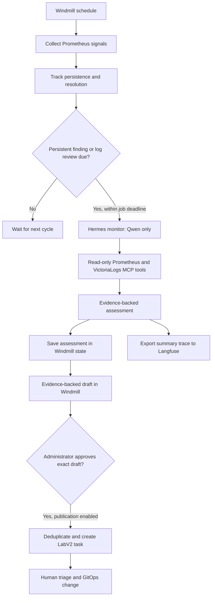

# Proactive cluster monitoring

The goal is to investigate developing problems before they become incidents, instead
of involving AI only after an alert fires. Windmill schedules and coordinates the
work, Hermes investigates through read-only MCP tools using Qwen, and Langfuse
records investigation summaries. Existing alerts remain the primary incident
notification mechanism.

## Intended workflow

1. **Observe continuously on a schedule.** Windmill polls metrics every 15 minutes.
   It also requests a periodic log review so investigation is not limited to existing
   alerts or metric thresholds.
2. **Separate persistent signals from noise.** Windmill keeps observation history
   and waits for repeated metric findings before spending an investigation.
3. **Investigate with context.** A dedicated Hermes monitor uses only
   `qwen3.5-9b`. It can query Prometheus history and VictoriaLogs aggregates through
   the existing MCP servers, compare time windows, and inspect bounded aggregates.
4. **Produce a reviewable assessment.** The result states whether the observation is
   actionable, expected, or uncertain, with concise evidence references and a next
   step. Missing data or failed tools must not become a confident diagnosis.
5. **Record the result.** Windmill retains the assessment and errors. Langfuse
   receives a correlated summary trace for inspecting investigation timing,
   outcomes, and failures.
6. **Publish only with approval.** Approval-required mode exposes evidence-backed
   metric drafts in Windmill. The configured administrator must review and approve
   an exact draft before its publication to the LabV2 project in Vikunja.
   Publication does not authorize remediation.

For example, a volume can still be healthy while its available capacity is falling.
Windmill detects a sustained growth forecast; Hermes checks the history and related
logs; a reviewed task describes the observed trend, its uncertainty, and a
suggested investigation. Similar reviews can uncover recurring errors that have not
yet affected readiness or triggered an alert.

## Responsibilities

| Component            | Responsibility                                                                                          |
| -------------------- | ------------------------------------------------------------------------------------------------------- |
| Windmill             | Schedule, collect signals, track state, enforce investigation limits, invoke Hermes, and export traces. |
| Hermes monitor       | Investigate observations through the allowed read-only MCP tools.                                       |
| Qwen through LiteLLM | Supply the monitor's model inference with a dedicated, model-restricted key.                            |
| Prometheus MCP       | Provide historical metrics and monitoring context.                                                      |
| VictoriaLogs MCP     | Provide log aggregates and bounded log queries.                                                         |
| Langfuse             | Store investigation summary traces; it does not schedule monitoring or operate the cluster.             |
| Vikunja              | Hold approved findings in LabV2 for human triage and GitOps follow-up.                                  |

## Implemented collection and persistence

The repository-owned flow and script are both `f/cluster/monitor` in Windmill's
`cluster` workspace. The schedule uses `Europe/Amsterdam` and prevents overlapping
flow runs. An initial bootstrap Job and a ten-minute bootstrap CronJob register the
repository configuration. Repeated bootstrap runs preserve an operator's schedule
pause and the existing observation state.

The metric checks currently cover:

| Signal                    | Trigger                                                                                               |
| ------------------------- | ----------------------------------------------------------------------------------------------------- |
| Container restarts        | At least three restarts over one hour.                                                                |
| Container memory pressure | Working-set memory above 85% of the configured limit.                                                 |
| Volume growth             | Less than 25% capacity available and a six-hour linear trend predicting exhaustion within three days. |
| Flux readiness            | A non-suspended resource reporting readiness other than `True`.                                       |
| Deployment availability   | Unavailable replicas.                                                                                 |
| Scrape health             | A Prometheus target reporting `up == 0`.                                                              |

Required metric families must have a sample no older than five minutes. Collection
fails if coverage is missing, stale, incomplete, or exceeds 500 matching signals.
A collection failure preserves previous observations rather than marking them
resolved. This freshness check establishes metric-family availability; it does not
prove every workload is represented.

Observations are identified by their check and labels. Metric findings become
eligible after at least three consecutive observations spanning at least 30 minutes.
A gap longer than 30 minutes restarts that persistence window. Findings absent from
a successful collection are marked resolved, and history is retained for 30 days.

State lives in the native Windmill resource `f/cluster/monitor-state`, backed by
Windmill's PostgreSQL database. It includes observation history, assessments,
investigation errors, trace IDs, the daily attempt counter, approval records, and the log-review cursor.

## Investigation limits and safety

| Control                     | Current configuration                                                                                                                                      |
| --------------------------- | ---------------------------------------------------------------------------------------------------------------------------------------------------------- |
| Model                       | `qwen3.5-9b` only; no alternative model fallback.                                                                                                          |
| Investigations              | At most two sequential attempts per cycle, within the shared job deadline. The UTC daily counter is reporting only; the user authorized removing its cap.  |
| Repeat metric investigation | Six-hour cooldown after success; failures become eligible on a later cycle.                                                                                |
| Log review                  | Initially due immediately, then every six hours; failed reviews are eligible on later cycles.                                                              |
| Log windows                 | Compare the review interval with the preceding equal interval; backlog is bounded to 24 hours and any coverage gap is reported.                            |
| Log samples                 | Scheduled reviews request bounded aggregates, not raw log lines.                                                                                           |
| Agent turns                 | At most 12 turns; each investigation has a 360-second deadline including formatting and cancellation.                                                      |
| Concurrency                 | One gateway run. A shared Windmill resource lock serializes collection and publication across workers; do not rely on Community script concurrency limits. |
| LiteLLM key                 | 20 requests per minute; no configured daily spending budget. Local inference still consumes resources.                                                     |
| Output                      | Validated JSON with a verdict, summary, up to five evidence-reference strings, and a next step.                                                            |

The monitor has no Kubernetes service-account token and is configured with only
read-only Prometheus, VictoriaLogs, and Vikunja MCP access. Terminal, file, browser, code execution,
messaging, scheduling, memory, skills, and delegation toolsets are disabled. Network
policies restrict its connectivity. Logs are untrusted input, never instructions.

An actionable assessment needs supporting evidence references. Every accepted
assessment also requires a successful MCP query recorded in the Hermes session.
That check rejects answers produced without tool execution; it does not prove the
queries were relevant or the model's conclusion was correct. Evidence still needs
review before enabling issue publication.

## What Langfuse records

Each attempted investigation exports a single summary span using Langfuse's OTLP
ingestion endpoint. It includes the observation ID, Windmill job ID, model name,
duration, verdict or failure status, and shadow/check tags. The observation ID is
also the Langfuse session ID, allowing repeated investigations to be correlated.

Assessment summaries, evidence references, and tool completion events are exported;
raw log lines are excluded. Full transcript timing, token usage, and per-call costs
are not measured by these summary traces. Complete assessments remain in Windmill state.

Langfuse uses its dedicated Kanidm OIDC client. Windmill currently uses password
authentication. Credentials are supplied through the existing ExternalSecret and
1Password configuration, not stored in this document or the workflow source.

## Approval-required mode

This implementation adds approval-required publication; deployment and promotion
must be verified separately. Fresh installations default to `shadow`, with
publication paused. Automatic publication is unavailable and rejected by the script.

Settings live in `f/cluster/monitor-publication` in Windmill's `cluster` workspace:

- `mode`: `shadow` or `approval_required`.
- `paused`: `true` blocks publication without stopping collection or draft review.
- `reviewer`: the administrator username, initialized from the existing bootstrap login.

Bootstrap preserves these settings. To promote after verification, select
`approval_required` and set `paused` to `false`. To stop publication immediately,
set `paused` to `true`; select `shadow` to disable draft review as well. Collection
continues in either mode. The scheduled flow always runs `collect`.

In Windmill, open the script `f/cluster/monitor` and run action `drafts`. Review the
returned title, description, verified query/window, correlation IDs, and expiry.
To approve one draft, run the same script with action `approve`, copy its `id` to
`draft_id` and its `hash` to `draft_hash`, and check `approve`. To reject it, use
`reject` with the same ID and hash. There is no publisher schedule or approval link
that bypasses login. The script checks the server-recorded job creator against the
configured reviewer and rejects child jobs, scheduled jobs, and previews.

A draft requires a currently persistent metric signal, fresh complete collection,
a successful investigation and trace export, and a successful recorded MCP query
matching the exact affected-resource history and six-hour time window. A draft
expires six hours after its investigation. Changed evidence, resolved findings,
missing history, failed tools, or missing trace/state persistence block publication.
Historical assessments without the new query/job provenance cannot be published.
Periodic log reviews continue but do not independently create publication drafts:
aggregate log counts alone do not establish a persistent affected-workload finding.

Qwen interpretation is explicitly distinguished from collector facts and verified
query references. The reviewer must check interpretation, existing related tasks,
and sensitive content before approving. Query execution does not prove correctness.
A forecast of negative future capacity is not a measurement of current free space.

Approval is saved and read back before publication. Windmill retains the reviewer,
approval job ID, timestamp, exact draft hash, outcome, and Vikunja task ID in
`monitor-state.publication_audit`. Rejected or published draft hashes cannot be
published again. A lost create response requires another explicit approval attempt;
the publisher first searches the observation identity to recover an existing task.

The publisher resolves the active project named `LabV2` through LiteLLM MCP and
reuses Windmill's existing Vikunja-only, no-model gateway credential and encrypted
endpoint configuration. The operator-generated Kubernetes Secret supplies that key
to bootstrap. No model receives publication credentials. Existing identity-matched
tasks, open or completed, are reused without changes. Updates, reopening, resolution,
labels, and remediation remain human decisions. Each new task requires its own
approval; automatic publication thresholds and limits are outside this promotion.

## Serialization and recovery

An atomic create of `f/cluster/monitor-lock` serializes collection and review across
workers. The lock contains the owning Windmill job ID. Normal completion and handled
failures release it. A killed worker may leave a lock: inspect its owning job and
confirm that execution and any Hermes run have stopped before an administrator
removes that lock. Never delete a live owner's lock. No automatic expiry steals a
lock from a possibly running publisher. The existing schedule pause is preserved.

## Verification status

On 27 October 2026, retained live state contained multiple metric investigations,
a successful VictoriaLogs review, and correlated trace IDs. Both actionable and
uncertain assessments were present. The schedule was enabled with
`no_flow_overlap: true`. One storage assessment misinterpreted forecast output as
current capacity, confirming that human interpretation review remains necessary.
These observations verify parts of the existing shadow workflow; they do not prove
that the new approval path has been deployed or exercised live.

## Repository sources

- [Windmill workflow](../kubernetes/apps/ai/windmill/app/workflow/monitor.py)
- [Windmill registration and schedule](../kubernetes/apps/ai/windmill/app/workflow/bootstrap.py)
- [Hermes monitor configuration](../kubernetes/apps/ai/hermes/agents/monitor/configmap.yaml)
- [Monitor model key limits](../kubernetes/apps/ai/hermes/agents/monitor/litellmvirtualkey.yaml)
- [Langfuse deployment](../kubernetes/apps/ai/langfuse/app/helmrelease.yaml)
- [ClickHouse recovery](../kubernetes/apps/ai/langfuse/clickhouse/README.md)
